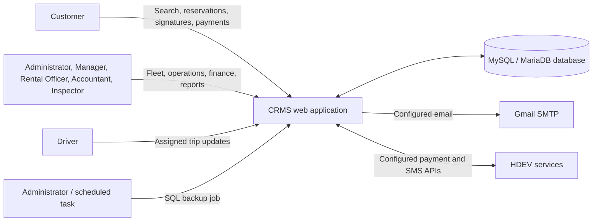
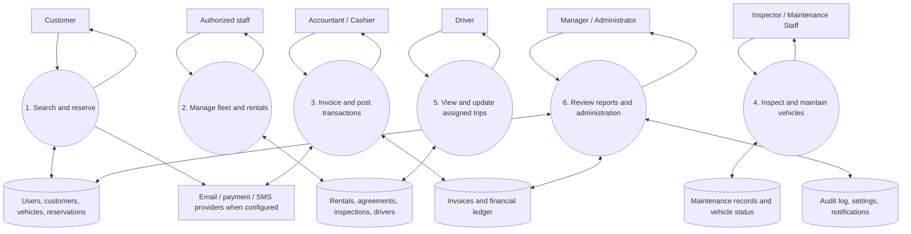
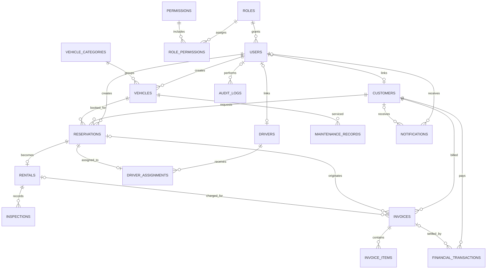

# CRMS SRS Compliance and Verification

**System:** Car Rental Management System (CRMS)  
**Baseline:** Group 1 Software Requirements Specification, October 2026  
**Review date:** 20 October 2026  
**Purpose:** Map the SRS to the application as implemented and identify work that must be completed during deployment.

## 1. Executive assessment

The application implements the SRS's main rental workflows: fleet and customer records, availability search, reservations, signed review decisions, rental agreements, vehicle handover and inspections, invoices and financial transactions, maintenance, drivers, notifications, dashboards, reports, role permissions, and audit records. The project also includes user, administrator, training, and technical guides.

This is a code and database review, not a production certification. Email, SMS, payment processing, HTTPS, scheduled jobs, restore rehearsals, and response-time targets depend on the deployment environment. A recovery rehearsal and performance test must be completed on the intended hosting environment before the corresponding operational targets can be claimed as verified.

## 2. Functional requirements traceability

| ID | SRS requirement | Status | Implementation evidence |
|---|---|---|---|
| FR-01 | User authentication | Implemented | Password hashing, login throttling, session ID rotation, logout, and forced first-login password change in `src/Auth.php` and `src/Controllers/AuthController.php`. |
| FR-02 | Role-based access | Implemented | Seven roles, permission checks, ownership checks, and role-specific dashboards in `src/Rbac.php`, `src/Auth.php`, and `views/dashboards/`. |
| FR-03 | Vehicle management | Implemented | Vehicle registration, details, status, search, and photographs in `src/Controllers/VehicleController.php` and `views/vehicles/`. |
| FR-04 | Customer management | Implemented | Staff customer records and customer self-service updates in `src/Controllers/CustomerController.php`. |
| FR-05 | Availability search | Implemented | Date, category, make/model, fuel, transmission, price, and sort filters in `src/Services/AvailabilityService.php` and `views/home/search.php`. |
| FR-06 | Reservation management | Implemented | Create, edit, cancellation, signed customer request, signed Rental Officer decision, date validation, and overlap checks in `src/Services/ReservationService.php`. |
| FR-07 | Rental agreements | Implemented | Agreement terms and rental records are created from eligible reservations in `src/Services/RentalService.php`; the rental view provides a printable agreement. |
| FR-08 | Pickup and return | Implemented | Handover, mileage, fuel, condition inspections, late-return and additional charge processing in `src/Services/RentalService.php`. |
| FR-09 | Payment management | Implemented | Invoice, receipt, full/partial payment, deposit, deduction, refund, approval, and reconciliation workflows in `src/Services/FinanceService.php` and `src/Services/InvoiceService.php`. Posted ledger entries are preserved. |
| FR-10 | Maintenance management | Implemented | Service jobs, maintenance holds, completion notes, and vehicle readiness decisions in `src/Services/MaintenanceService.php`. Inspector/Maintenance Staff schedule and update service work; Managers and Rental Officers have a view-only maintenance workspace. |
| FR-11 | Driver management | Implemented | Driver profiles, assignments, overlap checks, and assigned-trip updates in `src/Services/DriverService.php`. |
| FR-12 | Reports | Implemented | Role-scoped, date-filtered reports in `src/Controllers/AdminController.php`; CSV export and browser print/save-to-PDF are available in `views/admin/reports.php`. |
| FR-13 | Notifications | Implemented with scheduled setup | Event notifications are persisted in-app and sent by configured email/SMS integrations. `scripts/reminders.php` creates one-time return and payment reminders; the operator must schedule it. |
| FR-14 | Dashboard | Implemented | Separate dashboard templates and role-scoped summaries for all seven roles in `views/dashboards/` and `src/Services/DashboardService.php`. |
| FR-15 | Audit and backup | Implemented with an operational step | Important actions are audited. SQL export is available in the admin area and a CLI job supports recurring backups and retention. Recovery remains a documented manual restore into a separate database followed by verification. |

## 3. Quality and interface requirements

| SRS area | Status | Notes |
|---|---|---|
| Reliability and recovery | Partially implemented | SQL backups can be created manually or on a Windows schedule. The application does not automatically restore a database. Operators must retain an off-machine copy and rehearse restoration into a separate database. |
| Availability | Deployment-dependent | The SRS's 99% target requires production hosting and uptime monitoring; localhost development does not establish it. |
| Security | Application controls implemented; deployment-dependent controls remain | The app uses prepared PDO statements, output escaping, CSRF checks, password hashing, role and ownership checks, login throttling, secure session-cookie flags, and audit logging. Production must use HTTPS and protected database credentials. The installer locks after successful setup. |
| Scalability | Not yet verified | Relational indexes and bounded list views are present. Load and growth targets require measurement with expected data volume and concurrent users. |
| External interfaces | Conditional | Gmail SMTP, HDEV Mobile Money, and HDEV SMS are optional integrations that require service credentials, a reachable HTTPS callback where applicable, and provider availability. |
| User interface and usability | Implemented | Responsive layouts, role-specific navigation, search/filter forms, validation messages, status labels, and confirmation flows are provided in `views/` and `public/`. |
| Database | Implemented | `database/carrental.sql` defines relational entities, keys, indexes, uniqueness rules, and data checks. Prepared statements are used by the database layer. |
| Documentation | Implemented | `docs/user-guide.md`, `docs/admin-guide.md`, `docs/technical.md`, `docs/training-guide.md`, and this traceability document. |
| Testing | Automated checks present; deployment acceptance remains | `tests/run.php` covers key pricing, booking periods, roles, reservation approvals, notifications, and maintenance workflows. User acceptance and production-environment checks remain required. |
| Performance | Not yet verified | The SRS response-time targets are preliminary. Measure login, search, reservation/payment, dashboard, and report response times on the target host before accepting them. |
| Maintenance and support | Implemented for the project | The code is organized into controllers, services, views, database schema, and operational guides. Ongoing support and security updates remain an owner responsibility. |

## 4. User classes

| User class | Application workspace |
|---|---|
| System Administrator | User and role administration, settings, audit log, backups, reports, and system dashboard. |
| Business Manager | Operational and financial oversight, reports, and driver management; reservation and maintenance records are read-only. |
| Rental Officer | Vehicles and customers, reservations and approval decisions, agreements, handover, and returns. |
| Accountant/Cashier | Invoices, receipts, payments, deposits, refunds, approvals, and reconciliation. |
| Vehicle Inspector/Maintenance Staff | Maintenance work, vehicle readiness, and assigned inspection workflows. |
| Driver | Assigned trip schedule and trip progress for the linked driver profile. |
| Customer | Vehicle search, own reservations, signatures, payment information, receipts, and notifications. |

Customer and driver record access is scoped to the signed-in account or assigned work. A changed URL or record ID does not grant access to another customer's records.

## 5. Architecture and data-flow diagrams

### 5.1 System context



### 5.2 Level 0 data flow



### 5.3 Entity relationship diagram



The production schema is authoritative. This diagram summarizes the principal relationships; optional and audit foreign keys are omitted for readability.

## 6. Principal use cases

| Actor | Use case | Main result |
|---|---|---|
| Customer | Search and request a vehicle | Matching availability is shown; a valid request is signed and saved as pending review. |
| Rental Officer | Review a reservation | Approval or rejection is signed, noted, audited, and sent to the customer; approval rechecks availability. |
| Rental Officer | Start and close a rental | Agreement and handover/return records update vehicle and rental status; charges are calculated by server-side rules. |
| Accountant/Cashier | Record and reconcile a transaction | Invoice balance and receipt reflect posted entries; refunds or adjustments follow approval rules. |
| Inspector/Maintenance Staff | Schedule and complete servicing | Vehicle is blocked while work is open; return to service requires a documented readiness decision. |
| Manager | Review business activity | Date-filtered operational and financial reports are available according to permissions. |
| Driver | Update assigned trip | Progress and incident information is stored for the assigned reservation. |
| System Administrator | Manage access and backup | Accounts and settings are managed, actions are audited, and a protected SQL export can be created. |

## 7. Database examples and key safeguards

The schema includes `users`, `roles`, `permissions`, `customers`, `drivers`, `vehicle_categories`, `vehicles`, `reservations`, `driver_assignments`, `rentals`, `inspections`, `invoices`, `invoice_items`, `financial_transactions`, `maintenance_records`, `notifications`, `audit_logs`, and `system_settings`.

Examples of enforced data rules include unique vehicle registration numbers, unique reservation and invoice references, foreign keys between business records, valid reservation periods, non-negative monetary amounts, fuel levels from 0 to 100, and positive posted transaction amounts. Availability uses pickup-inclusive and return-exclusive time ranges, with a configurable turnaround buffer.

The financial transaction ledger is append-only at the service layer. Refunds and adjustments are separate entries with reasons and approval records where required; posted transactions are not edited or deleted through the application.

## 8. Budget and schedule arithmetic check

The supplied estimate line items correctly total **RWF 8,450,000**.

The listed sequential phase durations total **28 weeks** (excluding ongoing maintenance), not 28–29 weeks. Overlapping phases may change the calendar duration.

Both figures remain planning estimates and require review against current supplier quotations and the delivery plan.

## 9. Deployment actions before production sign-off

1. Serve the application over HTTPS and set secure database credentials outside source control.
2. Configure Gmail SMTP and, if used, HDEV payment/SMS credentials and a public HTTPS callback; verify each provider independently.
3. Schedule `scripts/backup.php` daily with Windows Task Scheduler or the host's scheduler. The default retention is 30 days; set `CRMS_BACKUP_RETENTION_DAYS` to change it. Schedule `scripts/reminders.php` daily to deliver due-return and payment reminders.
4. Copy SQL exports, uploaded vehicle photographs, and required configuration to storage outside the application host. The SQL export does not include uploaded files or secrets.
5. Rehearse a restore into a separate database, validate representative records and attachments, and document the recovery time.
6. Run user acceptance and load tests on the intended host; record measured response times against the preliminary SRS targets.
7. Remove starter credentials, restrict web access to deployment utilities, and train each role using the supplied guides.

## 10. Verification record

Run the automated suite from the project root with:

```powershell
C:\xampp\php\php.exe tests\run.php
```

The suite includes database-backed reservation and maintenance checks when the configured database is available. A successful local test run does not replace production provider checks, restore rehearsal, user acceptance, or performance measurement.
